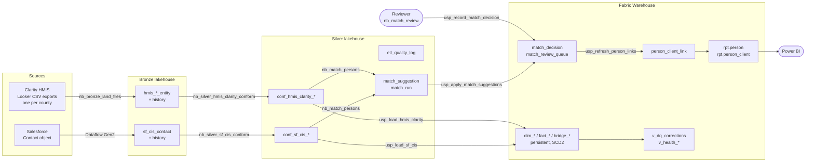
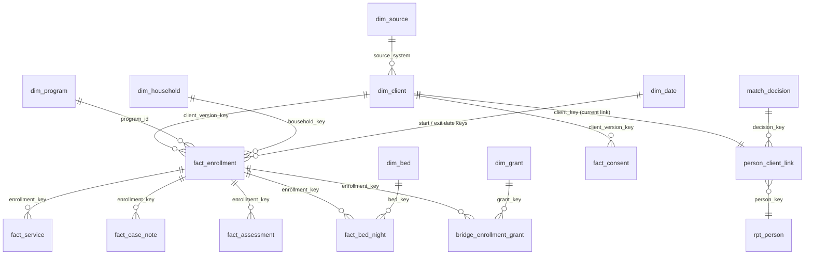

# Architecture

## Data flow

**Bronze** keeps each export exactly as it arrived, plus an append-only history table, so any week can be reprocessed.

**Silver** conforms each source to one shape per entity (client, enrollment, service and so on), with every source in the same table, partitioned by `source_system`. Each notebook runs its quality gates before it writes anything, and a gate that fails stops the run.

**Matching** reads only Silver and writes only IDs, scores and plain-language evidence ("same name and date of birth; shared phone"), never names or dates. Turning suggestions into decisions is the warehouse's job, so the notebook can be rerun freely.

**The warehouse** is loaded by one stored procedure per source system. Each one is a single transaction: insert new rows, update changed rows, flag rows that left the source, check every declared key, then `COMMIT`.

## Weekly orchestration (Fabric Data Pipeline)

| Step | Activity | Notes |
|---|---|---|
| 1 | Lookup enabled sources | `etl_source_config` decides what loads; a source with a `block_reason` never loads |
| 2 | ForEach source: land Bronze, conform Silver | a gate stop ends the run before the warehouse is touched |
| 3 | `nb_match_persons` | suggestions for the whole population |
| 4 | `nb_refresh_sql_endpoint` | syncs the lakehouse SQL endpoint instead of a fixed wait |
| 5 | ForEach source: loader procedure | one transaction per source; a failure rolls back that source only |
| 6 | `usp_apply_match_suggestions` | exact-rule decisions; rebuilds the review queue |
| 7 | `usp_refresh_person_links` | applies every decision; rebuilds `rpt.*` in the same transaction |
| on failure | Teams or Outlook alert | |

Pipeline concurrency is 1: Fabric detects write conflicts per table, so two runs at once would cancel each other. Every procedure takes the pipeline's run ID, so each row of `stage_load_log` and `warehouse_run_log` traces back to a run.

## Data model

A star schema with conformed dimensions shared by every source. Facts reference the client *version* they were loaded with (`client_version_key`), so a report can show a client as they were at the time of service.

| Group | Tables |
|---|---|
| Dimensions | `dim_client` (SCD2), `dim_client_identifier` (restricted), `dim_program` + `dim_program_history`, `dim_household`, `dim_organization`, `dim_grant`, `dim_funding_source`, `dim_service_item`, `dim_bed`, `dim_site`, `dim_staff`, `dim_date`, `dim_source`, `dim_hud_code` |
| Facts | `fact_enrollment`, `fact_service`, `fact_case_note`, `fact_assessment`, `fact_bed_night`, `fact_bed_availability`, `fact_consent`, `fact_enrollment_stage`, `fact_current_living_situation`, `fact_ce_event`, `fact_document`, `fact_financial_assistance` |
| Bridges | `bridge_household_client`, `bridge_client_source`, `bridge_enrollment_grant`, `bridge_program_site` |
| People | `match_decision`, `match_review_queue`, `person_client_link`, `apricot_profile_map`, `rpt.person`, `rpt.person_client` |
| Operations | `etl_source_config`, `warehouse_run_log`, `warehouse_schema_version`, `stage_load_log`, `stage_load_reject`, `kpi_target`, `security_user_program_access` |
| Views | `v_dq_corrections` (correction list), `v_health_*` (pipeline health), `v_person_golden`, `v_fact_enrollment_primary`, `v_kpi_target`, `v_apricot_worklist` |

211 keys are declared: 44 primary, 25 unique and 142 foreign. Fabric does not enforce them, so the warehouse checks them itself (design decision 5).

## Running locally

The demo runs the notebooks on local PySpark, with parquet standing in for Delta, and the T-SQL on DuckDB through `local/tsql_sim.py`. That's a small interpreter for the T-SQL these scripts use: batches split on `GO`, variables, `IF`/`WHILE`, `TRY`/`CATCH`, `THROW`, transactions with rollback, temp tables, `SELECT INTO`, stored-procedure bodies, and `NOT ENFORCED` constraints kept in a catalog the procedures' own checks read. `local/notebooks.py` lists every substitution it makes to a notebook, and each one asserts that the text it replaces still exists.

What the simulator can't check is covered by static lints in `tests/`, each one a Fabric rule learned on a real run:

| Lint | Fabric behavior it guards against |
|---|---|
| `lint_batch_columns.py` | a batch that adds or renames a column and then uses it fails to compile (Msg 207) |
| `lint_star_views.py` | a `SELECT *` view keeps its old column list after the table changes |
| `lint_view_grants.py` | dropping and recreating a view drops its direct grants |
| `lint_temp_widths.py` | `SELECT INTO` sizes a temp table's text columns from the first values it sees (Msg 2628) |

`04_security` (roles, denies, row-level security) and `00_clean_warehouse` (system catalog) need Fabric itself; `checks/check_view_security.sql` is the manual test for the permission behavior.
